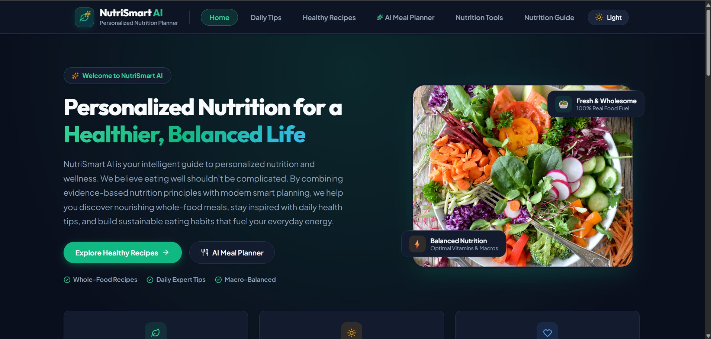
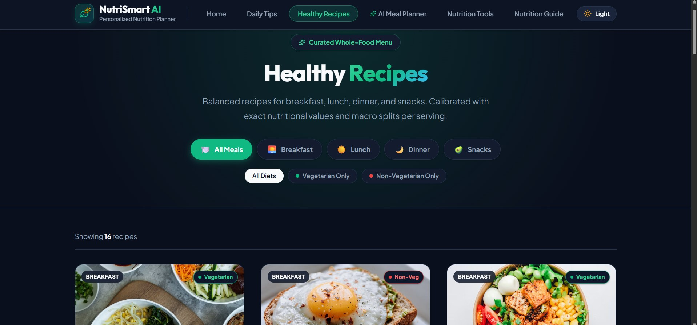
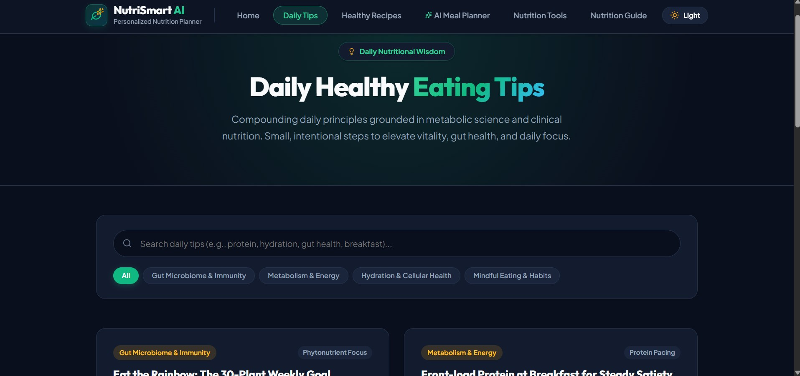
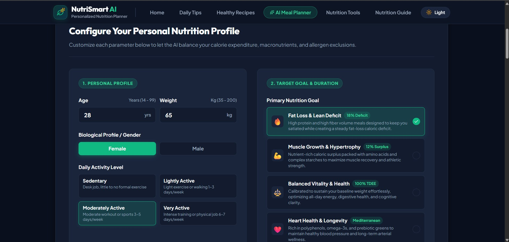
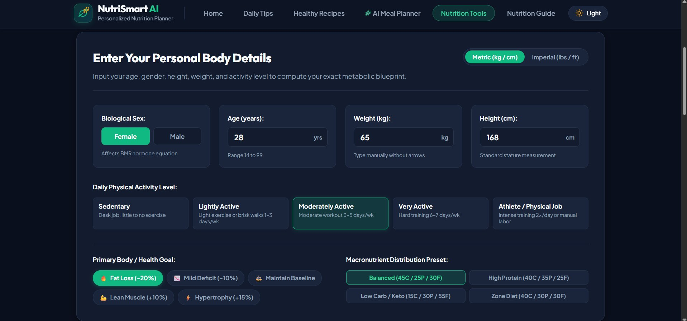
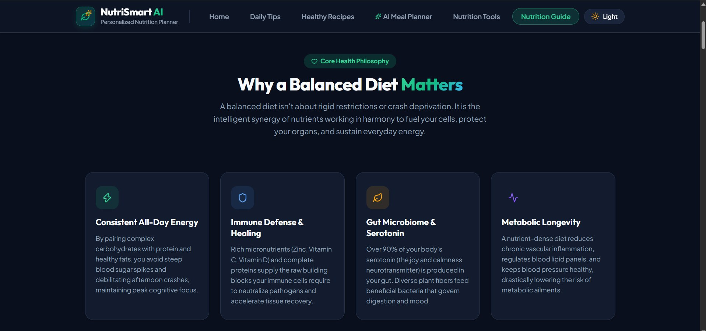
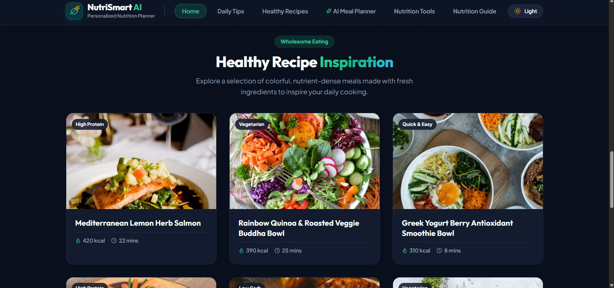

<div align="center">

#  NutriAI

### Personalized Nutrition & Meal Planning Web Application

<p>
  
  
  
  
</p>

**Explore healthy recipes, discover nutrition tips, plan meals, and estimate daily calorie and macronutrient needs.**

[View Repository](https://github.com/bhushan1395/NutriAI)

</div>

---

## 📖 About the Project

NutriSmart AI is a React-based nutrition and meal-planning web application designed to make everyday nutrition information and meal planning easier to explore. It brings together healthy recipes, educational nutrition content, meal-planning options, and browser-based nutrition calculators in one interface.

> **Project scope:** This repository currently contains a frontend prototype. Meal-plan examples use predefined sample data, and nutrition calculations run in the browser. The current version does not connect to a trained AI/ML model, backend API, or medical data service.

## ✨ Features

- **Nutrition dashboard** — Landing page with an introduction, featured content, and quick navigation.
- **Daily healthy tips** — Browse nutrition and healthy-eating information by topic.
- **Healthy recipes** — Explore recipe ideas with meal-category and dietary filters.
- **Meal planner** — Configure a sample nutrition profile and view predefined meal-plan options.
- **Nutrition tools** — Enter body details and explore BMI, BMR, calorie, and macronutrient estimates.
- **Nutrition guide** — Read educational content about balanced eating and general wellness.
- **Theme switcher** — Toggle between light and dark appearance.
- **Reusable React components** — UI sections are organized into separate components.

## 🖥️ Screenshots

<div align="center">

### Home Dashboard


### Healthy Recipes


### Daily Tips


### AI Meal Planner Interface


### Nutrition Tools


### Nutrition Guide


### Recipe Inspiration


</div>

## 🛠️ Tech Stack

- **React** — Component-based user interface
- **Vite** — Development server and build tooling
- **JavaScript (JSX)** — Application logic
- **CSS** — Styling and responsive layouts
- **Lucide React** — Interface icons
- **Browser Local Storage** — Persists the selected theme

## 🚀 Getting Started

### Prerequisites

Install [Node.js](https://nodejs.org/) (npm is included with Node.js).

### 1. Clone the repository

```bash
git clone https://github.com/bhushan1395/NutriAI.git
cd NutriAI
```

### 2. Install dependencies

```bash
npm install
```

### 3. Start the development server

```bash
npm run dev
```

Open the local URL shown in the terminal. Vite commonly uses:

```text
http://localhost:5173
```

### 4. Build for production

```bash
npm run build
```

To preview the production build locally:

```bash
npm run preview
```

## 📁 Project Structure

```text
NutriAI/
├── public/                  # Static public assets
├── screenshots/             # README project screenshots
├── src/
│   ├── assets/              # Images and frontend assets
│   ├── components/          # Reusable UI components and pages
│   ├── data/                # Recipe, meal-plan, and nutrition data
│   ├── App.jsx              # Main application
│   ├── App.css              # Application styles
│   ├── index.css            # Global styles
│   └── main.jsx             # React entry point
├── index.html
├── package.json
├── package-lock.json
├── vite.config.js
├── NutriSmart_AI_Project_Guide.pdf
└── PROJECT_OVERVIEW_2PAGE.html
```

## 🧮 Nutrition Calculations

The nutrition tools provide general estimates based on user-entered details:

- **BMI (Body Mass Index):** calculated from weight and height.
- **BMR (Basal Metabolic Rate):** estimated from personal inputs using the calculator's implemented equation.
- **Daily calorie estimate:** uses an activity-level adjustment to estimate energy needs.
- **Macronutrient targets:** displays suggested protein, carbohydrate, and fat distributions based on the selected preset.

These calculations are educational estimates and should not be treated as medical or dietetic recommendations.

## 🔭 Future Improvements

- Connect a backend and database for user accounts and saved meal plans.
- Integrate a trusted nutrition database or recipe API.
- Develop and evaluate a genuine recommendation or machine-learning model using suitable data.
- Add meal history, progress tracking, and personalized preferences.
- Add automated tests and accessibility improvements.

## ⚠️ Disclaimer

NutriSmart AI is an educational software project, not a medical device. It does not diagnose, treat, or prevent any health condition. Nutrition and calorie estimates are approximate and are not a substitute for advice from a qualified healthcare professional or registered dietitian.

## 👨‍💻 Author

**Bhushan Bhatkar**

- GitHub: [@bhushan1395](https://github.com/bhushan1395)

---
